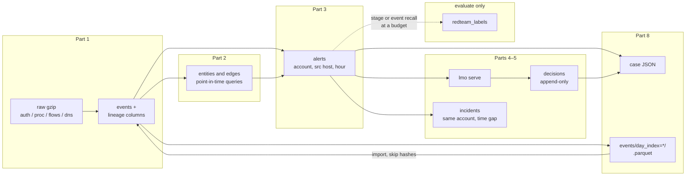

# Architecture

The system is a laptop pipeline, not a platform. Each box is a command. Labels
never enter the boxes on the left of the dashed line.

**Ingest** pays for provenance: every event keeps `src_file`, `src_line_no`,
and `src_line_hash`. Part 5's "show raw" only checks a hash that was stored
here.

**Graph** is a materialised ontology, rebuilt when `events` change. Queries
refuse a stale graph rather than answer from yesterday's world.

**Detect** scores `(account, source host, hour)`. It must not import
`writeback` and must not mention the label table.

**Serve** is localhost, one DuckDB lock, writable only so a judgement can be
appended. False positives leave the open queue. Scores do not change.
Incidents are a derived view of the current alerts (same account, time gap).

**Evaluate** is the only package allowed to join `redteam_labels`. A human
decision is not a label.

**Handoff** copies an alert (plus events and decisions) into JSON, or copies
`events` into Hive-style Parquet. Neither path reads labels. Part 9 loads
Parquet back with the same hash skip as a second ingest, and checks a case
file against warehouse hashes.

What would change at 100× is in [`scale-out.md`](scale-out.md), not a
different drawing of the same boxes.
